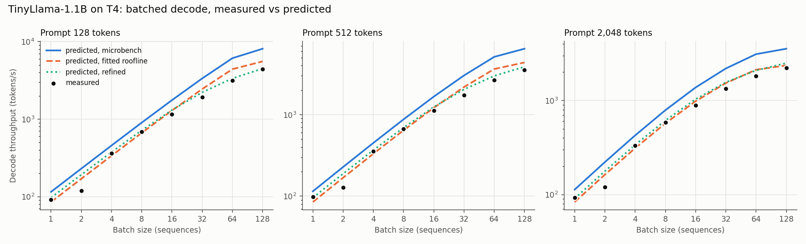

# Analytical Performance Model for LLM Inference

Predicts per-layer FLOPs, memory traffic, roofline placement and tokens/s for
Llama-style decoders on NVIDIA T4 and H100. The T4 predictions are validated
against measured llama.cpp runs on Colab: 8.7% decode and 4.4% prefill held-out
error. The H100 predictions use estimated efficiencies and have not been measured.



*TinyLlama-1.1B decode throughput on a Colab T4 (llama.cpp, fp16), batch 1-128.
Dots are measurements; lines are predictions. The refined model (dotted) adds a
compute/memory overlap term and attention bandwidth that grows with parallel work.
The 128- and 2048-token panels were held out from fitting.*

## Status

| Phase | State |
|---|---|
| 1. Per-op FLOP / byte model (prefill + decode, GQA, SwiGLU, KV cache) | done |
| 2. Rooflines for T4 and H100 | done |
| 3. Tokens/s prediction (TTFT, TPOT, decode and end-to-end throughput) | done |
| 4. Measured T4 runs (llama.cpp) and error report | done ([report](reports/validation_TinyLlama-1.1B_T4_llamacpp.md)) |
| 5. Sweep agent that writes up bottleneck shifts | done ([example report](reports/bottleneck_20261021-123905.md)) |
| Follow-up: T4 kernel probe of the small-batch anomaly | done ([report](reports/kernel_probe_t4.md)); per-kernel Nsight timings need a rerun with graph-node tracing |
| Follow-up: H100 calibration | not run; `notebooks/gpu_llamacpp_benchmark.ipynb` supports it on any Colab GPU |

## Layout

```
perfmodel/config.py    model presets (TinyLlama-1.1B, Llama-3.2-1B, Llama-3.1-8B)
perfmodel/hardware.py  GPU specs and efficiency profiles (peak / realistic priors)
perfmodel/ops.py       per-op FLOPs and bytes for one forward pass
perfmodel/predict.py   roofline timing, memory-fit check, throughput prediction
perfmodel/plots.py     roofline, throughput, time-breakdown and validation figures
perfmodel/validate.py  llama.cpp workloads, vectorized evaluation, efficiency fitting
scripts/run_baseline.py  writes results/*.csv and figures/*.png
scripts/validate.py    measured vs predicted error report -> reports/
notebooks/gpu_llamacpp_benchmark.ipynb  Colab measurement run (any T4/L4/A100/H100)
notebooks/llamacpp_kernel_probe.ipynb   fine batch sweep, CUDA-graphs A/B, Nsight kernel summary
notebooks/make_notebooks.py           generates both notebooks (shared setup cells)
scripts/analyze_probe.py              kernel probe report -> reports/kernel_probe_*.md
tests/                 sanity checks, plus fit recovery on synthetic measurements
```

```
pip install -r requirements.txt
python scripts/run_baseline.py                         # TinyLlama, realistic priors
python scripts/run_baseline.py --model Llama-3.1-8B --peak
python -m pytest -q
```

## Validation workflow

1. Open `notebooks/gpu_llamacpp_benchmark.ipynb` in Colab, pick a GPU runtime, and choose
   Run all (~30 min). The notebook detects the GPU, builds llama.cpp for its
   architecture, and sizes the batch grid to its memory.
2. Unzip the downloaded `<gpu>_llamacpp.zip` into `measurements/<gpu>_llamacpp/`.
3. `python scripts/validate.py measurements/<gpu>_llamacpp` detects the GPU from
   `env.json` and writes `reports/validation_*.md` with the error report. It also writes
   `results/calibrated_*.json`, which the sweep agent then picks up as that GPU's
   "calibrated" profile.

To investigate a step-time anomaly, run `notebooks/llamacpp_kernel_probe.ipynb` on the
same GPU type, unzip it into `measurements/<gpu>_kernel_probe/`, and run
`python scripts/analyze_probe.py measurements/<gpu>_kernel_probe`.

The report compares four efficiency profiles: datasheet **peak**, the hand-set
**prior**, **microbench** (bandwidth and FLOP/s measured with PyTorch on the
same GPU, no fitting) and **fitted**. The fitted profile is fit on batch-1
`llama-bench` rows only. The `batched-bench` rows (batch 1-128) are held out, so
their error is out-of-sample.

To match what llama.cpp actually executes, the predicted workloads include
prompt splitting into 512-token micro-batches (weights are re-read per chunk) and
decode over the exact context range each benchmark covers.

## Modeling assumptions

- **Ideal traffic**: each weight, activation and KV entry crosses DRAM once
  (perfect tiling reuse, fused FlashAttention-style attention, no S x S
  score matrix in memory).
- **Op time** = `combine(FLOPs / (peak * eff_compute), bytes / (BW * eff_memory)) + launch overhead`.
  `combine` is `max` by default (classic roofline) or the soft maximum
  `(t_c^p + t_m^p)^(1/p)` when calibrated. Ops run serially; there is no overlap between ops.
- Attention can optionally have its bandwidth scaled by available parallelism
  (`Efficiency.attention_half_work`). It is off by default and calibrated in validation.
- Matmuls and attention use the FP16 tensor-core peak. Norms and activations use the FP32 CUDA-core peak.
- Prefill attention exploits causal masking (half the score matrix). Logits
  are computed only for each sequence's last position.
- Static batching: all sequences share prompt and generation length.
- Memory fit = weights + full KV cache <= 90% of device memory (activation
  workspace ignored).
- `REALISTIC` efficiencies (T4: 45% compute, 80% bandwidth, 4 us/kernel;
  H100: 70%, 85%, 3 us) are **priors** that phase 4 calibrates.

## Validation results: TinyLlama-1.1B fp16 on a Colab T4 (llama.cpp)

Training data: 35 rows (batch-1 `llama-bench` and batched rows at a 512-token prompt).
Held out: 29 batched rows at 128- and 2048-token prompts, batch 1-128.

| Held-out MAPE | decode | prefill |
|---|---|---|
| Datasheet peaks | 103% | 313% |
| Hand-set prior | 47% | 96% |
| Measured bandwidth / FLOP/s (no fitting) | 52% | 56% |
| Fitted classic roofline (max) | 13.5% | 3.5% |
| **Refined** | **8.7%** | **4.4%** |

What closed the gap, in order of size:

1. **The T4 is power-capped, not compute-capped.** Under load it sat at its 70 W
   limit 100% of the time, and the SM clock dropped to a median of 690 MHz
   (boost: 1590 MHz). Effective tensor-core throughput is ~1/4 of the 65 TFLOPS
   datasheet figure. Memory clocks did not throttle, so bandwidth held at 85% of peak.
2. **Decode attention needs parallelism to use the bandwidth.** At batch 1 there
   are only 4 KV heads' worth of work for 40 SMs, so attention reached ~20% of bandwidth.
   The refined model scales attention bandwidth by `w / (w + 12.9)`, where
   `w` = sequences x KV heads.
3. **Compute and memory barely overlap within a kernel.** The fitted soft-max
   exponent is 1.1, so op time is close to `t_compute + t_memory`, not `max`.
   This matters for mid-size batches near the ridge point.
4. **Per-kernel overhead is ~10 us,** about 3 ms of the ~10 ms batch-1 decode step.

Not modeled, so flagged and excluded by explicit rules:

- **Batch-2 decode is slower per step than batch 4** (17 ms vs 11 ms), at every prompt
  length. That is likely a llama.cpp kernel-dispatch effect.
- **The first batched-bench measurement was a cold start,** 3.6x slower than the same
  workload in `llama-bench`.

A follow-up **kernel probe** on the T4 ([report](reports/kernel_probe_t4.md)) traced the
small-batch anomaly to llama.cpp itself:

- **The slow batch moved with the llama.cpp version.** With a newer commit (`7775ffb`),
  batch 2 is normal (11.1 ms, model -5%) and **batch 3** is now the slow one (14.4 ms vs
  10.6 ms at batch 4). On the same hardware, that points to which matmul kernel llama.cpp
  picks for small batches, not to the GPU.
- **CUDA graphs are not the cause.** Disabling them changes batch 2 and 3 by only +6-7% and
  other batches by at most 2%.
- **Three matmul paths are in play for fp16 weights:** `mul_mat_vec_f`, the tiled `mul_mat_f`,
  and cuBLAS GEMMs with fp16/fp32 conversion kernels. The Nsight capture recorded CUDA
  graphs as single items, so per-kernel decode timings need a rerun with
  `--cuda-graph-trace=node` (the probe notebook now does this).
- **A second step appears between batch 16 (13.2 ms) and 20 (15.7 ms).** From there on, the
  model under-predicts by 10-14%.

The remaining decode error is a consistent +14-17% over-prediction at batch 16-32.
With flash attention off, prefill runs ~2x slower than predicted, because the model
assumes fused attention.

## Bottleneck sweep agent

```
python scripts/bottleneck_agent.py                     # default task: all models x both GPUs
python scripts/bottleneck_agent.py --task "When does Llama-3.1-8B on H100 stop benefiting from batching?"
```

The agent is Claude Opus 5.5 using the SDK tool runner. It has four tools over the model:

- `describe_setup`
- `sweep` (grid of batch x context)
- `find_crossover`, which bisects for the exact batch or context where attention
  overtakes the weight matmuls, the matmuls cross the ridge point, launch overhead
  drops below 10%, or memory runs out
- `op_breakdown`

The agent decides what to explore and writes a Markdown report to `reports/`. Every
number in the report is checked against the tool outputs, and unmatched numbers are
listed in the report's provenance section. The full tool-call log goes to
`results/agent_runs/`. It needs `ANTHROPIC_API_KEY`, set in the environment or in a
git-ignored `.env`.

The example run made 58 tool calls for ~$0.86. All 190 numbers in its report
were traced to tool output.

The report notes one result it could not explain: on the T4, Llama-3.2-1B's batch-1
attention crossover comes *later* than TinyLlama's, while on the H100 it comes
earlier. The cause is the calibrated attention-parallelism term. Llama-3.2-1B has
8 KV heads to TinyLlama's 4, so at batch 1 its attention reaches 8/(8+12.9) ≈ 38% of
bandwidth instead of 4/(4+12.9) ≈ 24%. The uncalibrated H100 profile has no such
term, so its ordering follows raw KV bytes per token.

## Early observations (before validation)

- TinyLlama decode at batch 1 is weight-bandwidth bound. The T4 ceiling is ~150 tok/s
  at peak bandwidth and ~110 tok/s with the realistic prior.
- As batch grows, the weight GEMMs climb the roofline toward the ridge point,
  and **KV-cache reads in attention become the dominant cost**. On the T4 at
  2k context the crossover falls between batch 32 and 64. Attention intensity is stuck near
  `n_heads / n_kv_heads` FLOP/byte no matter the batch size, so batching does not help it.
- On the H100, kernel launch overhead is about half of the batch-1 decode step for a
  1B model. That makes small-model decode there latency-bound, not bandwidth-bound.
