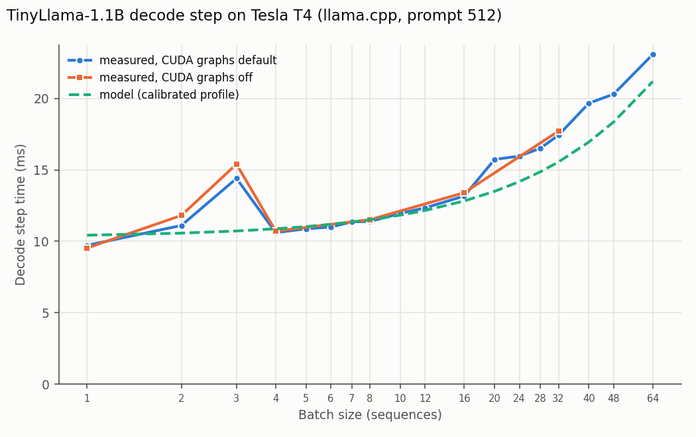

# Kernel probe: TinyLlama-1.1B decode on Tesla T4 (llama.cpp)

llama.cpp `7775ffb7e4`, measured 2026-10-21T20:32:11+00:00.

**Note:** the validation run on this GPU used llama.cpp `d454a204ef`; this probe used `7775ffb7e4`. Kernel dispatch can differ between them.
Decode step = `t_tg / tg` from llama-batched-bench at prompt 512, 64 generated tokens.
The model column uses the **calibrated** profile for T4.

## A. Step time by batch size

| batch | measured ms | model ms | model error % |
|---|---|---|---|
| 1 | 9.72 | 10.43 | 7.29 |
| 2 | 11.11 | 10.57 | -4.83 |
| 3 | 14.41 | 10.72 | -25.57 |
| 4 | 10.61 | 10.88 | 2.51 |
| 5 | 10.88 | 11.03 | 1.44 |
| 6 | 11.00 | 11.19 | 1.72 |
| 7 | 11.36 | 11.35 | -0.10 |
| 8 | 11.39 | 11.51 | 1.04 |
| 10 | 11.95 | 11.83 | -1.00 |
| 12 | 12.34 | 12.16 | -1.48 |
| 16 | 13.17 | 12.83 | -2.62 |
| 20 | 15.73 | 13.50 | -14.20 |
| 24 | 15.97 | 14.18 | -11.19 |
| 28 | 16.52 | 14.87 | -9.97 |
| 32 | 17.44 | 15.56 | -10.77 |
| 40 | 19.67 | 16.95 | -13.82 |
| 48 | 20.31 | 18.36 | -9.62 |
| 64 | 23.09 | 21.19 | -8.23 |

Batch sizes that step >5% slower than some larger batch (impossible for any additive
cost model, so a sign of a different code path):
3 (14.4 ms).

## B. CUDA graphs off vs default

| batch | graphs off ms | default ms | change % |
|---|---|---|---|
| 1 | 9.53 | 9.72 | -1.93 |
| 2 | 11.81 | 11.11 | 6.33 |
| 3 | 15.41 | 14.41 | 6.94 |
| 4 | 10.72 | 10.61 | 1.03 |
| 8 | 11.52 | 11.39 | 1.10 |
| 16 | 13.41 | 13.17 | 1.78 |
| 32 | 17.72 | 17.44 | 1.61 |

If an anomalous batch's penalty disappears with graphs off (or its neighbours slow down to
match it), the gap is CUDA-graph capture. If it persists, it is the kernel choice.

## C. Kernel summary: not usable

Only 12 kernel launches per decode step were recorded (a step runs
~290). Nsight recorded llama.cpp's CUDA graphs as single items, so the decode kernels inside
them are missing and the per-step timings mostly reflect prefill. Rerun experiment C with
`nsys profile --cuda-graph-trace=node` (the current probe notebook does this).

Kernels that were captured (outside graphs), for reference:

- `turing_h1688gemm_128x128_ldg8_tn`
- `void mul_mat_f<__half2, (int)32, (int)16, (int)8, (bool)0>(const T1 *, const float *, cons`
- `void mul_mat_vec_f<__half, __half, (int)2, (int)256, (bool)0, (bool)0>(const T1 *, const f`
- `turing_h1688gemm_256x128_ldg8_tn`
- `void mul_mat_f<__half2, (int)32, (int)4, (int)8, (bool)0>(const T1 *, const float *, const`
- `void convert_unary_cont_vec4<__half, float>(const void *, T2 *, long)`
- `void convert_unary_cont_vec4<float, __half>(const void *, T2 *, long)`
- `turing_h1688gemm_128x128_ldg8_stages_32x1_tn`
