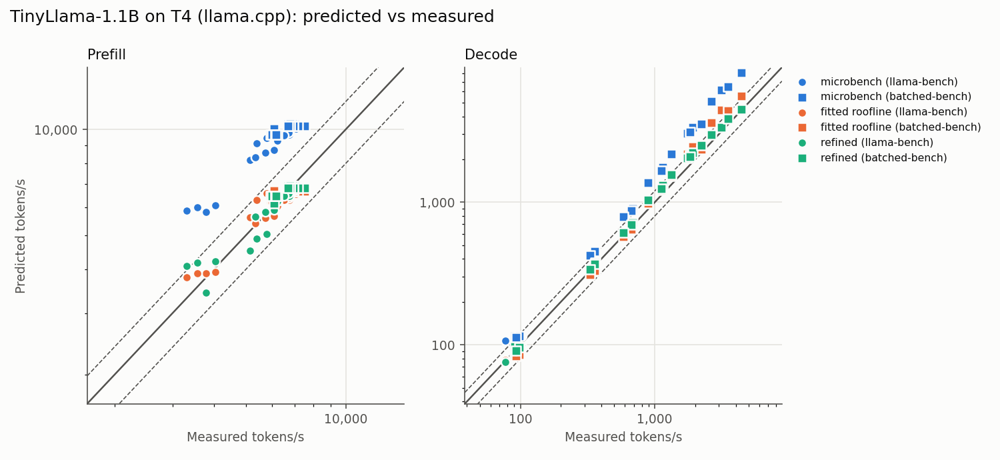

# Validation: TinyLlama-1.1B on T4 (llama.cpp)

GPU: Tesla T4 | driver 580.82.07 |
llama.cpp `d454a204ef` | measured 2026-10-21T17:32:36+00:00

Error = `predicted / measured - 1` in tokens/s; MAPE = mean |error|.
Training rows: llama-bench (batch 1, flash attention on) + batched-bench at prompt
512 (35 rows). Held out: batched-bench at the other
prompt lengths (29 rows). Anomalies excluded
from both (4 rows, listed below).

## Held-out error (MAPE %)

| profile | decode | prefill |
|---|---|---|
| peak | 103.2 | 312.8 |
| prior | 47.4 | 95.7 |
| microbench | 51.8 | 56.4 |
| roofline | 13.5 | 3.5 |
| refined | 8.7 | 4.4 |

## Training error (MAPE %)

| profile | decode | prefill |
|---|---|---|
| peak | 90.5 | 281.7 |
| prior | 36.9 | 89.8 |
| microbench | 41.8 | 51.6 |
| roofline | 15.0 | 6.1 |
| refined | 6.8 | 5.7 |

## Efficiency profiles

| profile | compute_eff | memory_eff | attn_memory_eff | attn_half_work | overhead_us | overlap_p |
|---|---|---|---|---|---|---|
| peak | 1.000 | 1.000 | 1.000 | - | 0.000 | inf (max) |
| prior | 0.450 | 0.800 | 0.800 | - | 4.000 | inf (max) |
| microbench | 0.347 | 0.853 | 0.853 | - | 4.000 | inf (max) |
| roofline | 0.221 | 0.553 | 0.553 | - | 0.000 | inf (max) |
| refined | 0.257 | 0.853 | 0.853 | 12.881 | 9.624 | 1.11 |

## GPU clocks during the run

While busy (626 samples at 0.5 s), the median SM clock was **690 MHz** (max 1590 MHz, so ~43% of the boost clock the 65 TFLOPS datasheet figure assumes), median power 66.4 W, software power cap active in 100% of samples, max temperature 82 C.

## Anomalies (excluded from fit and from the error tables)

| anomaly | source | phase | batch | prompt | depth | measured_tok_s | pred_refined | err_refined |
|---|---|---|---|---|---|---|---|---|
| cold start | batched-bench | prefill | 1 | 128 | 0 | 1605.0 | 5038.3 | 213.9 |
| non-monotonic decode | batched-bench | decode | 2 | 0 | 128 | 118.5 | 192.0 | 62.0 |
| non-monotonic decode | batched-bench | decode | 2 | 0 | 512 | 128.7 | 188.9 | 46.8 |
| non-monotonic decode | batched-bench | decode | 2 | 0 | 2048 | 119.8 | 177.4 | 48.2 |

Flash attention **off** (llama-bench, refined profile), mean signed error: decode -4.8%, prefill +116.1%. The model assumes fused attention, so positive error means unfused attention costs more than the model counts.

## Full error table (%)

| split | phase | profile | n | mape_pct | bias_pct | worst_pct |
|---|---|---|---|---|---|---|
| anomaly | decode | peak | 3 | 147.2 | 147.2 | 159.0 |
| anomaly | decode | prior | 3 | 75.2 | 75.2 | 83.2 |
| anomaly | decode | microbench | 3 | 85.4 | 85.4 | 93.9 |
| anomaly | decode | roofline | 3 | 36.8 | 36.8 | 43.3 |
| anomaly | decode | refined | 3 | 52.3 | 52.3 | 62.0 |
| anomaly | prefill | peak | 1 | 919.3 | 919.3 | 919.3 |
| anomaly | prefill | prior | 1 | 617.9 | 617.9 | 617.9 |
| anomaly | prefill | microbench | 1 | 489.6 | 489.6 | 489.6 |
| anomaly | prefill | roofline | 1 | 309.1 | 309.1 | 309.1 |
| anomaly | prefill | refined | 1 | 213.9 | 213.9 | 213.9 |
| held-out | decode | peak | 14 | 103.2 | 103.2 | 202.6 |
| held-out | decode | prior | 14 | 47.4 | 47.4 | 117.4 |
| held-out | decode | microbench | 14 | 51.8 | 51.8 | 94.9 |
| held-out | decode | roofline | 14 | 13.5 | 8.6 | 40.7 |
| held-out | decode | refined | 14 | 8.7 | 8.4 | 17.1 |
| held-out | prefill | peak | 15 | 312.8 | 312.8 | 334.5 |
| held-out | prefill | prior | 15 | 95.7 | 95.7 | 104.7 |
| held-out | prefill | microbench | 15 | 56.4 | 56.4 | 65.0 |
| held-out | prefill | roofline | 15 | 3.5 | 2.2 | 10.0 |
| held-out | prefill | refined | 15 | 4.4 | 4.1 | 9.2 |
| train | decode | peak | 11 | 90.5 | 90.5 | 178.6 |
| train | decode | prior | 11 | 36.9 | 36.9 | 105.7 |
| train | decode | microbench | 11 | 41.8 | 41.8 | 93.6 |
| train | decode | roofline | 11 | 15.0 | 2.7 | 37.3 |
| train | decode | refined | 11 | 6.8 | 3.7 | 17.5 |
| train | prefill | peak | 24 | 281.7 | 281.7 | 387.5 |
| train | prefill | prior | 24 | 89.8 | 89.8 | 125.7 |
| train | prefill | microbench | 24 | 51.6 | 51.6 | 77.4 |
| train | prefill | roofline | 24 | 6.1 | -0.3 | 17.3 |
| train | prefill | refined | 24 | 5.7 | -1.1 | 23.1 |

## Figures

