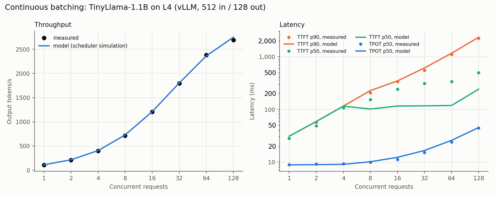
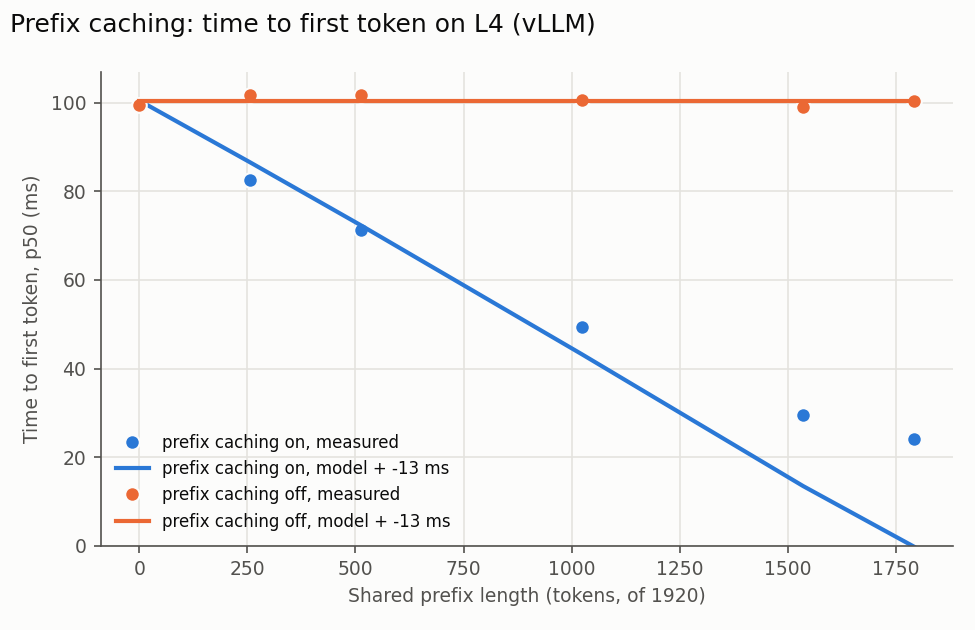
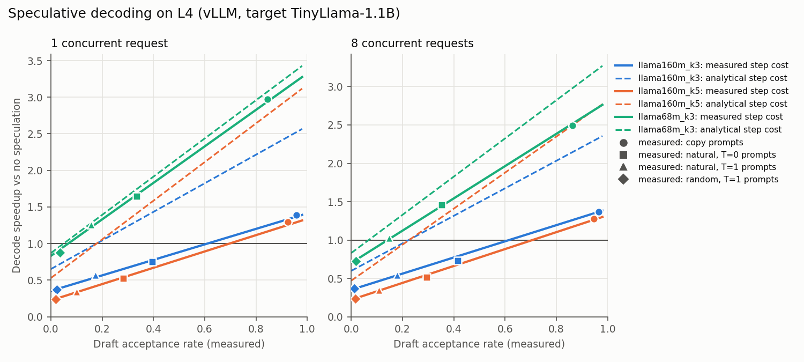

# vLLM serving: measurements vs model (L4)

vLLM 0.32.0 on NVIDIA L4, TinyLlama-1.1B fp16, measured 2026-10-28T00:35:26+00:00.

## 1. Continuous batching

Closed loop: at each concurrency level, that many clients each send a request (random
512-token prompt, exactly 128 output tokens) as soon as their previous one finishes.

**Model.** A vLLM efficiency profile is fitted to the median TPOT at each level, treating
each engine step as one decode per running request plus an amortized share of new prompts'
chunked prefill, all sharing one read of the weights. Memory efficiency is pinned to the
measured 86% of peak bandwidth; the fit gives compute efficiency 0.344,
3.1 us per kernel and overlap exponent 2.23. The
profile then drives a **step-by-step simulation of the scheduler** under the same load.
Each step decodes one token per running request and fills the rest of a 2,048-token
budget (read from the data) with queued prompts in arrival order. The simulation predicts
throughput, TTFT, TPOT and end-to-end latency together.

| Metric | Model error (MAPE) |
|---|---|
| Output throughput | 1.3% |
| End-to-end latency p50 | 1.6% |
| TPOT p50 | 4.3% |
| TTFT p90 | 6.5% |
| TTFT p50 | 37.8% |

| concurrency | out tok/s | model | TTFT p50 ms | model  | TTFT p90 ms | model   | TPOT p50 ms | model    | E2E p50 ms | model     |
|---|---|---|---|---|---|---|---|---|---|---|
| 1 | 109.6 | 110.5 | 28.3 | 31.1 | 29.0 | 31.1 | 9.0 | 8.9 | 1,167.5 | 1,158.8 |
| 2 | 209.3 | 214.3 | 48.7 | 58.9 | 55.7 | 58.9 | 9.2 | 8.9 | 1,223.0 | 1,194.8 |
| 4 | 396.6 | 404.0 | 107.7 | 115.4 | 110.1 | 115.4 | 9.3 | 9.1 | 1,291.4 | 1,267.5 |
| 8 | 713.1 | 727.6 | 153.3 | 101.7 | 207.6 | 228.3 | 10.0 | 10.2 | 1,434.7 | 1,401.6 |
| 16 | 1,205.6 | 1,209.7 | 243.7 | 116.1 | 336.6 | 347.0 | 11.3 | 12.3 | 1,692.5 | 1,682.9 |
| 32 | 1,793.4 | 1,802.1 | 311.7 | 116.9 | 552.8 | 614.2 | 15.3 | 16.6 | 2,266.2 | 2,228.9 |
| 64 | 2,380.9 | 2,362.5 | 336.4 | 118.7 | 1,102.4 | 1,163.1 | 24.1 | 25.9 | 3,405.6 | 3,409.6 |
| 128 | 2,692.1 | 2,748.7 | 500.0 | 242.4 | 2,247.9 | 2,344.6 | 44.7 | 45.3 | 6,081.6 | 5,892.6 |

**Requests arrive in lockstep waves.** Every request generates exactly 128 tokens, so
requests that start together finish together, and their clients' next requests arrive
together. At concurrency 128 the first wave has 128
requests and later waves most often have 4. Within a wave,
prompts are prefilled 4 per step, so TTFT steps up with arrival order. The
simulation reproduces this (same wave sizes and same within-wave step pattern), and the
large first wave sets TTFT p90.

**What the model misses: a delay before a new request is first scheduled.** Median TTFT
at high concurrency is set by the small later waves. Measured minus simulated median TTFT
is -3 ms at 1, -10 ms at 2, -8 ms at 4, 52 ms at 8, 128 ms at 16, 195 ms at 32, 218 ms at 64, 258 ms at 128:
negligible up to 4 concurrent
requests, then growing with the number of open streams. Within a wave, the gaps between
first tokens match the simulated step length, so the extra time comes before a request's
first step. The likely cause is CPU contention on the VM: vLLM's single Python API
server streams tokens for every running request while the Python client on the same VM
parses those streams. CPU load was not measured, so this is a hypothesis.

No request was ever preempted (vLLM's `num_preemptions` counter stayed at
0): the KV cache had room for every running sequence.

## 2. Prefix caching

One request at a time, with a 1920-token prompt whose first N tokens
are shared with an earlier request (each prefix length uses its own prefix, warmed by one
excluded request). With caching off, TTFT stays flat at
101 ms. With caching on, it falls to
24 ms at a 1,792-token shared prefix, a
**4.2x** speedup.

**Model.** Prefill only the uncached tokens, attending over the cached prefix. Each cached
token saves 42.1 us of measured TTFT; the model predicts
56.2 us, so measured / model = 0.75. The profile's
compute efficiency (0.344) was fitted on decode-heavy steps, while a
1920-token prefill runs large matmuls. Using the microbenchmark's
sustained matmul efficiency (0.447) instead predicts 44.4 us per
cached token (0.95x the measured value). Measured minus that
prediction is then nearly flat, 2-12 ms
across prefix lengths: a fixed per-request cost, plus prefill compute that the model
captures once it uses the efficiency of large matmuls.

| prefix tokens | TTFT on ms | TTFT off ms | speedup | model compute ms | measured - model ms |
|---|---|---|---|---|---|
| 0 | 99.5 | 99.6 | 1.0 | 113.8 | -14.3 |
| 256 | 82.7 | 101.8 | 1.2 | 99.9 | -17.2 |
| 512 | 71.4 | 101.9 | 1.4 | 85.7 | -14.3 |
| 1024 | 49.5 | 100.7 | 2.0 | 56.5 | -7.0 |
| 1536 | 29.4 | 99.1 | 3.4 | 26.7 | 2.7 |
| 1792 | 24.1 | 100.4 | 4.2 | 13.1 | 11.0 |

## 3. Speculative decoding

Each configuration ran on four prompt types chosen to span draft acceptance: a passage
being **copied** (draft and target agree), **natural** text at temperature 0 and 1, and
**random** tokens at temperature 1. Speedup = TPOT without speculation / TPOT with it, for
the same prompts and concurrency. Acceptance comes from vLLM's counters: acceptance rate =
accepted / drafted tokens, and tokens per step = 1 + accepted / drafts.

**How speedup depends on acceptance.** A speculative step costs the same however many
of its draft tokens are accepted. Across the four prompt types, the measured step cost
varies by only 2-4% within a configuration, even though acceptance ranges from
0.01 to 0.97. So

> speedup = tokens per step x (target step time / speculative step time)

which is linear in tokens per step: within each configuration their correlation is
0.998-1.000. Using step costs measured on the *other* three prompt types
(leave one out), this predicts the measured speedups with 3.3% average error
(worst 8.0%).
The best case was llama68m_k3 on copy prompts at
concurrency 1: 2.97x at 85% acceptance.

**Draft cost decides whether it pays off.** The break-even acceptance rate is
(speculative step / target step - 1) / k. The 160M draft costs several times what its size
suggests, so it needs much higher acceptance than the 68M draft to help:

| config | concurrency | target step ms | spec step ms | spread across prompts | model spec step ms | draft step ms (implied) | draft step ms (model) | break-even accept. (measured) | break-even accept. (model) |
|---|---|---|---|---|---|---|---|---|---|
| llama160m_k3 | 1 | 8.99 | 25.48 | 3% | 13.60 | 5.53 | 1.57 | 0.61 | 0.18 |
| llama160m_k3 | 8 | 9.42 | 26.84 | 4% | 15.31 | 5.76 | 1.92 | 0.62 | 0.22 |
| llama160m_k5 | 1 | 8.99 | 40.34 | 3% | 16.77 | 6.28 | 1.57 | 0.70 | 0.18 |
| llama160m_k5 | 8 | 9.42 | 42.73 | 4% | 19.49 | 6.56 | 1.92 | 0.71 | 0.23 |
| llama68m_k3 | 1 | 8.99 | 10.82 | 3% | 10.18 | 0.64 | 0.43 | 0.07 | 0.05 |
| llama68m_k3 | 8 | 9.42 | 13.44 | 2% | 11.02 | 1.29 | 0.49 | 0.14 | 0.07 |

**Where the analytical model fails: the draft step.** The model's verify + draft costs
give speedup errors of llama160m_k3 78%, llama160m_k5 126%, llama68m_k3 12%. The
"implied" draft cost (measured step minus modeled verification, per draft token) shows
why: the 68M draft runs close to the model, while the 160M draft takes several times its
weight-read time. A per-kernel overhead fitted to the 68M draft does not explain it
either, so the analysis uses the measured draft cost. The cause inside vLLM's draft-model
path was not profiled.

| config | prompts | concurrency | acceptance | tokens/step | speedup | pred. (measured cost) | pred. (analytical) |
|---|---|---|---|---|---|---|---|
| llama160m_k3 | copy | 1 | 0.96 | 3.87 | 1.39 | 1.35 | 2.52 |
| llama160m_k3 | copy | 8 | 0.97 | 3.90 | 1.36 | 1.37 | 2.33 |
| llama160m_k3 | natural | 1 | 0.39 | 2.18 | 0.75 | 0.78 | 1.42 |
| llama160m_k3 | natural | 8 | 0.42 | 2.25 | 0.73 | 0.79 | 1.34 |
| llama160m_k3 | natural_t1 | 1 | 0.17 | 1.52 | 0.57 | 0.53 | 0.99 |
| llama160m_k3 | natural_t1 | 8 | 0.18 | 1.54 | 0.55 | 0.54 | 0.92 |
| llama160m_k3 | random_t1 | 1 | 0.02 | 1.07 | 0.37 | 0.38 | 0.70 |
| llama160m_k3 | random_t1 | 8 | 0.01 | 1.04 | 0.37 | 0.36 | 0.62 |
| llama160m_k5 | copy | 1 | 0.92 | 5.62 | 1.29 | 1.23 | 2.97 |
| llama160m_k5 | copy | 8 | 0.95 | 5.73 | 1.28 | 1.25 | 2.69 |
| llama160m_k5 | natural | 1 | 0.28 | 2.41 | 0.53 | 0.55 | 1.28 |
| llama160m_k5 | natural | 8 | 0.29 | 2.47 | 0.52 | 0.55 | 1.16 |
| llama160m_k5 | natural_t1 | 1 | 0.10 | 1.50 | 0.34 | 0.33 | 0.79 |
| llama160m_k5 | natural_t1 | 8 | 0.11 | 1.54 | 0.35 | 0.34 | 0.72 |
| llama160m_k5 | random_t1 | 1 | 0.02 | 1.10 | 0.24 | 0.25 | 0.58 |
| llama160m_k5 | random_t1 | 8 | 0.02 | 1.08 | 0.24 | 0.24 | 0.51 |
| llama68m_k3 | copy | 1 | 0.85 | 3.54 | 2.97 | 2.91 | 3.08 |
| llama68m_k3 | copy | 8 | 0.86 | 3.59 | 2.49 | 2.54 | 2.98 |
| llama68m_k3 | natural | 1 | 0.34 | 2.01 | 1.65 | 1.69 | 1.74 |
| llama68m_k3 | natural | 8 | 0.35 | 2.06 | 1.46 | 1.43 | 1.71 |
| llama68m_k3 | natural_t1 | 1 | 0.16 | 1.47 | 1.26 | 1.21 | 1.28 |
| llama68m_k3 | natural_t1 | 8 | 0.15 | 1.44 | 1.02 | 1.00 | 1.20 |
| llama68m_k3 | random_t1 | 1 | 0.04 | 1.11 | 0.88 | 0.93 | 0.96 |
| llama68m_k3 | random_t1 | 8 | 0.02 | 1.06 | 0.73 | 0.75 | 0.88 |
